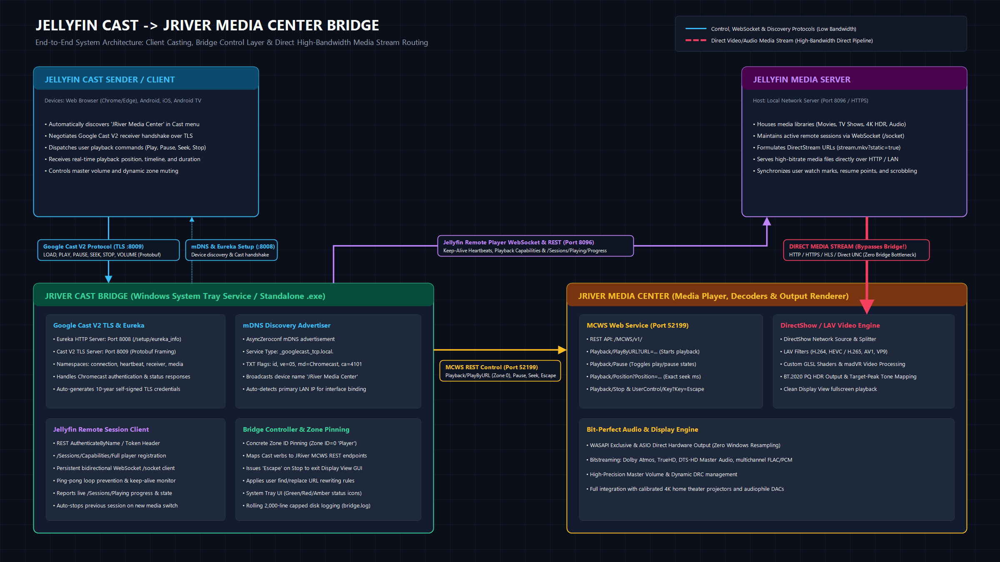

# JCastBridge: Jellyfin & JRiver Media Center Bidirectional Cast Bridge

A high-performance Windows system tray service and bidirectional Cast bridge connecting **JRiver Media Center**, **Jellyfin**, and **Google Chromecast** hardware:
- **Inward Casting (Jellyfin / Cast Senders → JRiver)**: Makes JRiver Media Center appear as an active remote playback target and Google Cast V2 receiver with full remote control (Play, Pause, Seek, Volume, Stop), zone pinning, automatic fullscreen display exit, and timeline synchronization.
- **Outward Casting (JRiver → Chromecast Audio / Google Nest / Speaker Groups)**: Discovers LAN Cast devices and Google Home Speaker Groups via mDNS and exposes each as a native UPnP/DLNA playback zone inside JRiver Media Center (`Playing Now → Zones`), enabling whole-home audio streaming directly from JRiver without heavy third-party servers.

Available both as a **standalone, zero-dependency Windows executable (`JCastBridge.exe`)** and as a **Python service**.

---

## Architecture Overview

### Inward Casting Architecture (Jellyfin / Cast Senders → JRiver)



```
                      ┌────────────────────────────────────────────────┐
                      │              Jellyfin Ecosystem                │
                      │  (Web Client, Mobile Apps, TV, Desktop Client) │
                      └───────┬────────────────────────────────┬───────┘
                              │                                │
                 Direct Jellyfin WebSocket               Google Cast V2
                 Remote Control Protocol                 (TLS / Port 8009)
                              │                                │
                              ▼                                ▼
       ┌────────────────────────────────────────────────────────────────────────┐
       │                 Jellyfin → JRiver Bridge Application                   │
       │                                                                        │
       │  ┌─────────────────────────┐            ┌───────────────────────────┐  │
       │  │ Jellyfin Remote Client  │            │ Cast V2 Protocol Receiver │  │
       │  │ • Persistent Device ID  │            │ • Eureka HTTP (Port 8008) │  │
       │  │ • User / Token Auth     │            │ • TLS Server (Port 8009)  │  │
       │  │ • Session Capabilities  │            │ • AsyncZeroconf mDNS      │  │
       │  │ • Bidirectional Keep-   │            │ • Device Auth Handshake   │  │
       │  │   Alive & Heartbeats    │            │ • Protocol Buffer Framing │  │
       │  │ • Real-time Progress    │            │ • Clean Connection Drain  │  │
       │  └───────────┬─────────────┘            └─────────────┬─────────────┘  │
       │              │                                        │                │
       │              └───────────────────┬────────────────────┘                │
       │                                  ▼                                     │
       │                      ┌───────────────────────┐                         │
       │                      │   Bridge Controller   │                         │
       │                      │ • Metadata Inspection │                         │
       │                      │ • URL Stream Routing  │                         │
       │                      │ • Play/Pause Toggle   │                         │
       │                      │ • Auto-Stop on Switch │                         │
       │                      └───────────┬───────────┘                         │
       │                                  │                                     │
       │                                  ▼                                     │
       │                      ┌───────────────────────┐                         │
       │                      │   JRiver MCWS Client  │                         │
       │                      │ • Alive Health Checks │                         │
       │                      │ • Concrete Zone ID    │                         │
       │                      │   Pinning (Zone ID=0) │                         │
       │                      │ • Bounded Buffer Wait │                         │
       │                      │ • Escape on Stop (GUI)│                         │
       │                      └───────────┬───────────┘                         │
       └──────────────────────────────────┼─────────────────────────────────────┘
                                          │ MCWS REST (Port 52199, Zone=ID)
                                          ▼
                      ┌───────────────────────────────────────┐
                      │          JRiver Media Center          │
                      │ • High-performance DirectShow/LAV    │
                      │ • Custom GLSL & madVR video rendering │
                      │ • Bit-perfect audio output            │
                      └───────────────────────────────────────┘
```

### Outward Casting Architecture (JRiver → Chromecast Audio & Speakers)

```
┌────────────────────────────────────────────────────────────────────────┐
│                          JRiver Media Center                           │
│   • Playing Now → Zones (e.g. "Living Room [Cast]", "Whole House")     │
│   • Internal DLNA / HTTP Audio Server (Port 52199)                     │
└───────────┬────────────────────────────────────────────────┬───────────┘
            │ UPnP AVTransport / RenderingCtl                │ HTTP Audio Stream
            │ SOAP Actions (Port 8010)                       │ (FLAC / WAV / MP3)
            ▼                                                │
┌─────────────────────────────────────────────────────────┐  │
│                JCastBridge (Outward Cast)               │  │
│  ┌───────────────────────────────────────────────────┐  │  │
│  │ SSDP Server (UDP 1900)                            │  │  │
│  │ • Responds to JRiver M-SEARCH discovery queries   │  │  │
│  │ • Broadcasts ssdp:alive / byebye notifications    │  │  │
│  └───────────────────────────────────────────────────┘  │  │
│  ┌───────────────────────────────────────────────────┐  │  │
│  │ Virtual UPnP Service (Port 8010)                  │  │  │
│  │ • Serves description.xml & SCPD XML descriptors   │  │  │
│  │ • Translates SetAVTransportURI, Play, Pause, Stop │  │  │
│  │   Seek, and SetVolume SOAP calls into Cast events │  │  │
│  └─────────────────────────┬─────────────────────────┘  │  │
│                            │                            │  │
│  ┌─────────────────────────▼─────────────────────────┐  │  │
│  │ Cast V2 Outward Client Engine                     │  │  │
│  │ • Launches Default Media Receiver (CC1AD845)      │  │  │
│  │ • Dispatches LOAD, PLAY, PAUSE, SEEK, VOLUME      │  │  │
│  │ • Maintains TLS Keep-Alives & Heartbeats          │  │  │
│  └─────────────────────────┬─────────────────────────┘  │  │
└────────────────────────────┼────────────────────────────┘  │
                             │ Cast V2 TLS (Port 8009)       │
                             ▼                               │
┌─────────────────────────────────────────────────────────┐  │
│         Google Chromecast Audio / Nest Speakers /       │  │
│                 Google Speaker Groups                   │◄─┘
│   Pulls, decodes, and outputs synchronized audio stream │
└─────────────────────────────────────────────────────────┘
```

### Core Architecture & Key Features
1. **Direct Jellyfin Remote Player Session**:
   - Authenticates directly against your Jellyfin Server API (`/Users/AuthenticateByName` or API key).
   - Registers JRiver as an active remote player using a permanent device identifier (`/Sessions/Capabilities/Full`).
   - Maintains a persistent WebSocket (`/socket`) with bidirectional keep-alives and ping-pong loop prevention to ensure the remote player bar never detaches.
   - Reports live playback state (`/Sessions/Playing/Progress`) with `CanSeek: True` and `PlayMethod: DirectStream`.
   - **Accurate Idle / Stop Detection**: Distinguishes between initial stream buffering and genuine playback stop. Releasing the Jellyfin session (`/Sessions/Playing/Stopped`) when JRiver stops allows back-to-back video casting without session locks.
   - **Auto Clean-Up on Media Switch**: When a new video is cast while an older title is active, the bridge immediately closes the prior session cleanly before starting the new stream.
2. **JRiver MCWS Integration & Zone Pinning**:
   - **Concrete Zone ID Pinning**: Captures the concrete `ZoneID` (e.g. `ZoneID=0` "Player") upon playback start and pins all subsequent commands (`Pause`, `Play`, `Seek`, `Stop`) directly to that zone, preventing loss of control if GUI window focus shifts.
   - **Automatic Fullscreen Display Exit**: On stop, issues an `Escape` key command via MCWS to cleanly exit JRiver's fullscreen "Display View" back to the standard or Theater View GUI.
   - Direct stream URL formulation with container extensions (`stream.{container}?static=true`) or local/UNC paths (`\\server\share\...`) for optimal DirectShow/LAV splitters.
3. **Google Cast V2 Protocol Receiver**:
   - Advertises via mDNS Zeroconf (`_googlecast._tcp`).
   - Serves Cast V2 protocol buffers over TLS on port 8009 and Eureka device metadata on port 8008.
   - Emulates Chromecast device handshakes for browser and mobile Cast senders.
4. **Bidirectional Outward Casting (JRiver → Chromecast Audio & Speakers)**:
   - Discovers LAN Chromecast devices, Google Nest speakers, and multi-room Speaker Groups via mDNS.
   - Exposes each device as a virtual UPnP/DLNA MediaRenderer zone directly inside JRiver (`Playing Now → Zones`).
   - Listens on SSDP (UDP 1900) and serves lightweight UPnP endpoints (Port 8010) to translate JRiver playback verbs (`SetAVTransportURI`, `Play`, `Pause`, `Seek`, `Stop`, `SetVolume`) into Google Cast V2 commands.
   - Eliminates the need for heavy, closed-source Java background servers (like BubbleUPnP Server).

---

## Windows System Tray Application

The bridge includes a native Windows notification area (System Tray) runner (`run_tray.py` / `JCastBridge.exe`):

```
┌────────────────────────────────────────────────────────┐
│ Windows System Tray (Taskbar Notification Area)        │
│                                                        │
│  [ (●) Green / (●) Red / (●) Amber / (●) Gray Icon ]   │
│      │                                                 │
│      ├─ Status: JRiver: OK | Jellyfin: OK              │
│      ├─ [✓] Enabled                                    │
│      ├─ [✓] Enable File Logging                        │
│      ├─ Open Configuration Directory                   │
│      ├─ Edit config.yaml                               │
│      ├─ View Live Logs                                 │
│      ├─ Check Connection Now                           │
│      └─ Exit                                           │
└────────────────────────────────────────────────────────┘
```

- **Dynamic Color Indicators**:
  - 🟢 **Green**: Both JRiver MCWS and Jellyfin Server are reachable and healthy.
  - 🔴 **Red**: Connection error (either JRiver is offline or Jellyfin is unreachable).
  - 🟡 **Amber**: Starting up / connecting.
  - ⚪ **Gray**: Disabled / paused.
- **Context Menu Controls**:
  - **Status Header**: Real-time health summary of both endpoints.
  - **Enabled [✓]**: Toggle the bridge on/off without closing the tray application.
  - **Enable File Logging [✓]**: Toggle live file logging to `bridge.log` without restarting.
  - **Open Configuration Directory**: Launches Windows Explorer directly to the folder containing `config.yaml`.
  - **Edit config.yaml**: Opens your settings file in your default text editor.
  - **View Live Logs**: Opens `bridge.log` for immediate inspection.
  - **Check Connection Now**: Triggers an immediate health check.
  - **Exit**: Cleanly drains network transports, joins event loop threads, and exits with zero console error tracebacks.
- **2,000-Line Rolling Log Cap**:
  - `bridge.log` is capped at 2,000 lines. When reached, it rotates with a clean header to prevent disk bloat.

---

## Standalone Executable (`.exe`) Build & Deployment

You can compile the entire application into a single, standalone executable that requires **no Python installation**, no `.venv`, and no environment variables on target machines.

### 1. Compile the Executable
> **Important**: If `JCastBridge.exe` is currently running, right-click its System Tray icon and select **Exit** first so Windows does not lock the binary during compilation.

In the project directory, double-click or run:
```cmd
build_exe.bat
```
This script will:
- Check for PyInstaller (auto-installing via `pip` if needed).
- Compile `run_tray.py` using `JCastBridge.spec` with full C-extension bundling (`cryptography`, `pystray`, `zeroconf`, `aiohttp`) into a single windowless binary.
- Automatically clean previous builds (`--clean --noconfirm`).
- Output the executable to `dist\JCastBridge.exe`, copy `config.yaml`, and stage the TLS certificates in `dist\certs\`.

### 2. Standalone Deployment
Copy the compiled `dist\` folder to any location on your Media Player PC (e.g. `C:\Tools\JCastBridge\` or `D:\Apps\JCastBridge\`):
```
C:\Tools\JCastBridge\
├── JCastBridge.exe          (Standalone ~24MB windowless binary)
├── config.yaml              (Application configuration)
└── certs/                   (TLS certificates for Cast V2)
    ├── cast_bridge.crt
    └── cast_bridge.key
```

- **Freeze-Aware Paths**: When running as an `.exe`, all paths (`config.yaml`, `bridge.log`, and `certs/`) resolve automatically to the directory where `JCastBridge.exe` is located.
- **Embedded Cryptography Engine**: The executable includes compiled native cryptography support. If the `certs/` folder is ever removed, `JCastBridge.exe` will generate fresh 10-year self-signed certificates on-the-fly without needing external OpenSSL binaries.
- **Auto-Config Generation**: If `JCastBridge.exe` is run in an empty folder without `config.yaml`, it automatically creates a fully commented starter `config.yaml` template.
- **Auto-Start with Windows**: Create a shortcut to `JCastBridge.exe`, press `Win + R`, type `shell:startup`, and paste the shortcut into your Windows Startup folder.

---

## Python Installation & Setup (Alternative to `.exe`)

If running from source rather than the standalone executable:

### 1. Requirements
- **Windows 10 / 11**
- **Python 3.10+** (Python 3.12, 3.13, or 3.15)
- **JRiver Media Center** (v28+) with Media Network / MCWS enabled
- **Jellyfin Server** (v10.8+ or v12.x) on the local network

### 2. Install Dependencies
Open Command Prompt or PowerShell in the project directory:
```cmd
pip install -r requirements.txt
```

### 3. Enable MCWS in JRiver Media Center
1. In JRiver Media Center, open **Tools → Options → Media Network**.
2. Check **Use Media Network to share this library and enable DLNA**.
3. Note your **MCWS port** (default: `52199`).
4. If authentication is enabled, note your username and password.

---

## Configuration (`config.yaml`)

Edit `config.yaml` to match your local network IP addresses:

```yaml
# ─── JRiver Media Center settings ────────────────────────────────────────────
jriver:
  host: "192.168.xxx.xxx"      # IP address of the machine running JRiver MC (e.g. 192.168.1.100)
  port: 52199                  # MCWS port (default 52199, HTTPS default 52200)
  username: null               # MCWS username (null = no authentication)
  password: null               # MCWS password
  zone: null                   # Zone name or null for active zone targeting
  use_ssl: false               # true to use HTTPS for MCWS

# ─── Cast receiver settings ──────────────────────────────────────────────────
cast:
  device_name: "JRiver Media Center"   # Name shown in Cast / Play On menus
  port: 8009                           # Cast protocol port (standard 8009)
  eureka_port: 8008                    # Eureka device info HTTP port
  cert_file: "certs/cast_bridge.crt"   # TLS certificate (auto-generated)
  key_file: "certs/cast_bridge.key"    # TLS private key  (auto-generated)
  device_id: null                      # Unique device ID (auto-generated if null)
  bind_address: null                   # IP to bind to (null = auto-detect LAN IP)
  status_interval: 1.0                 # Seconds between status updates

# ─── Jellyfin Server settings ────────────────────────────────────────────────
jellyfin:
  url: "http://192.168.xxx.xxx:8096"   # URL of your Jellyfin server (e.g. http://192.168.1.50:8096)
  username: "your_jellyfin_username"   # Jellyfin username
  password: "your_jellyfin_password"   # Jellyfin password
  api_key: null                        # Optional: API key from Dashboard -> API Keys
  device_name: "JRiver Media Center"

# ─── URL rewrite rules ───────────────────────────────────────────────────────
# Optional find->replace rules for media URLs if needed across network subnets:
url_rewrite:
  # "http://localhost:8096": "http://192.168.xxx.xxx:8096"

# ─── Outward Casting settings (JRiver → Chromecast Audio / Speakers) ─────────
# Enables bidirectional casting: discovers LAN Chromecasts and exposes each
# device as a native UPnP/DLNA playback zone inside JRiver Media Center.
outward_cast:
  enabled: false                       # Set to true to enable JRiver -> Cast streaming
  upnp_port: 8010                      # Local HTTP port for virtual UPnP renderers
  zone_name_format: "{name} [Cast]"    # Naming template for JRiver's Zone list
  include_speaker_groups: true         # Expose Google Cast Speaker Groups as zones
  # include_devices:                   # Whitelist: only expose these specific devices
  #   - "Living Room Speaker"
  #   - "Whole House Audio"
  # exclude_devices:                   # Blacklist: ignore these specific devices
  #   - "Basement TV"

# ─── Logging ─────────────────────────────────────────────────────────────────
log_level: "INFO"   # DEBUG for detailed protocol trace, INFO for normal operation
```

---

## How to Run

### Option A: Standalone Executable (Recommended)
Double-click `JCastBridge.exe`. It runs silently in your Windows System Tray.

### Option B: Python Launchers
- **Silent Background Launch**:
  - Double-click **`start_tray_silent.vbs`** or **`start_tray_silent.bat`**.
  - Windowless execution; sits directly in the Windows system notification area.
- **Visible Diagnostic Console Launch**:
  - Double-click **`start_tray.bat`** (or run `python run_tray.py`).
  - Opens a visible console displaying live startup logs and pauses on error for easy debugging.

### Option C: CLI Mode
For console-only or headless servers:
```powershell
python run.py
```
For verbose protocol debugging:
```powershell
python run.py -v
```

---

## How to Cast from Jellyfin

1. Open Jellyfin in your browser, phone, tablet, or TV app.
2. Click the **Cast / Play On** icon in the navigation bar.
3. Select **"JRiver Media Center"**.
4. Play any video or audio title.
5. JRiver will begin playing the media with full Play, Pause, Unpause, and Seek synchronization on your Jellyfin client.
6. When playback finishes or you press Stop on JRiver, the session releases automatically, allowing another video to be cast immediately.

---

## How to Cast from JRiver Media Center to Chromecast (Outward Casting)

With **Outward Casting**, JRiver Media Center can stream directly to any Google Cast device, Google Nest smart speaker, or multi-room Google Home Speaker Group on your local network.

### 1. Enable Outward Casting in `config.yaml`
Set `outward_cast.enabled: true` in your `config.yaml`:
```yaml
outward_cast:
  enabled: true                        # Set to true to activate outward casting
  upnp_port: 8010                      # Local HTTP port for virtual UPnP renderers
  zone_name_format: "{name} [Cast]"    # Naming template for JRiver's Zone list
  include_speaker_groups: true         # Expose Google Cast Speaker Groups as zones
```

### 2. Enable JRiver Media Network (DLNA Server)
JRiver needs its built-in DLNA/HTTP server active so Chromecast devices can stream the audio:
1. In JRiver Media Center, open **Tools → Options → Media Network**.
2. Check **Use Media Network to share this library and enable DLNA**.
3. Under **Advanced**, ensure **DLNA Server** is checked.

### 3. Select the Cast Zone in JRiver
1. Start or restart `JCastBridge.exe` (or `python run_tray.py`).
2. JCastBridge scans your network via mDNS Zeroconf, discovers all Chromecast receivers, and advertises them via SSDP.
3. In JRiver Media Center, navigate to **Playing Now → Zones** (or look under **Drives & Devices → UPnP / DLNA Servers**).
4. You will see your Cast devices listed with the suffix configured in `zone_name_format` (e.g. `Living Room Speaker [Cast]`, `Whole House Audio [Cast]`).
5. Select the zone and press Play on any audio album, track, or playlist.

### 4. Playback Controls & Streaming
- **Transport Controls**: Play, Pause, Unpause, Seek, and Stop commands from JRiver GUI, JRemote, or web interfaces map directly to the Chromecast Default Media Receiver (`CC1AD845`).
- **Volume Synchronization**: Adjusting volume in JRiver automatically sets the hardware volume on the Chromecast or Google Nest speaker.
- **Whole-Home Audio (Speaker Groups)**: Google Cast synchronized multi-room audio is fully supported. Select any defined Speaker Group zone in JRiver to play music simultaneously across multiple speakers with hardware-synchronized clocking.
- **Device Whitelist / Blacklist Filtering**: Avoid cluttering JRiver's zone list with household smart TVs or displays by specifying `include_devices` or `exclude_devices` in `config.yaml`.

#### Recommended JRiver DLNA Audio Settings for Chromecast
For the best streaming experience to Chromecast Audio and Nest speakers:
1. In JRiver, go to **Tools → Options → Media Network → Add or configure DLNA servers...**.
2. Select your DLNA server profile and click **Audio**.
3. Under **Mode**, choose:
   - **Original / Never convert** (if streaming standard FLAC, MP3, AAC, or WAV up to 96kHz / 24-bit).
   - **Specified output format: PCM 16-bit L16** or **FLAC** for uncompressed, bit-perfect casting of high-resolution files.

---

## Compatibility with Non-Jellyfin Cast Apps

### Primary Design & Testing Focus
The primary design, implementation, and multi-clip testing of this project has been focused specifically on **Jellyfin clients casting to JRiver Media Center** using a hybrid architecture: direct Jellyfin WebSocket player registration paired with a Google Cast V2 receiver.

### Compatibility with Other Cast Senders
Because the application implements standard Google Cast V2 protocol components (mDNS Zeroconf advertising on `_googlecast._tcp`, Eureka HTTP service on port 8008, TLS protocol buffers on port 8009, and the standard Cast media namespace `urn:x-cast:com.google.cast.media`), the bridge can also accept streams from generic third-party Cast senders.

When a compatible third-party app casts to "JRiver Media Center", the bridge receives the standard `LOAD` payload, forwards the stream URL to JRiver MCWS via `Playback/PlayByURL`, and relays Play, Pause, Seek, Stop, and Volume adjustments into JRiver with full zone pinning and fullscreen display exit.

#### Expected Working Apps & Use Cases
- **Mobile Cast Utilities (Android / iOS)**: Apps like **BubbleUPnP**, **Web Video Caster**, **LocalCast**, and **AllCast** streaming personal video, audio, or DLNA files directly to JRiver.
- **Desktop Media Players**: Players such as **VLC Media Player** (`Playback` → `Renderer` → `JRiver Media Center`).
- **Web Browsers (Chrome / Edge / Chromium)**: Casting direct HTML5 `<video>` or `<audio>` elements from websites that expose direct, unencrypted media URLs.

#### Known Limitations with Non-Jellyfin Apps
1. **No DRM or Commercial Streaming Services (Netflix, Disney+, Prime Video, Max)**:
   - These services require Google Widevine DRM and run proprietary web receiver apps inside an official Google Chromium receiver.
   - This bridge is a lightweight headless protocol emulator without a Widevine Content Decryption Module (CDM). Encrypted commercial streams are not supported.
2. **Proprietary App Namespaces (YouTube, Spotify)**:
   - **YouTube** uses custom Cast namespaces (`urn:x-cast:com.google.youtube.mdx`) and delegates playback to its own web app rather than sending direct stream URLs.
   - **Spotify** relies on Spotify Connect or encrypted vendor payloads rather than standard Cast V2 media URLs.
3. **Google Hardware Attestation (`deviceauth`)**:
   - Official Chromecast hardware uses proprietary Google-signed private keys for hardware verification. The bridge responds with a standard internal challenge response; while Jellyfin, Chrome, and open cast utilities bypass this check cleanly, some strict Google Play Services applications may enforce hardware verification and decline connection.
4. **Network Stream URL Reachability**:
   - The media URL supplied in the `LOAD` message must be network-accessible from the PC running JRiver. If a mobile app attempts to stream a local sandboxed file via `localhost` without exposing an HTTP endpoint on its LAN IP, JRiver will be unable to retrieve the media.
5. **Session Management Differences**:
   - Jellyfin enjoys **dual-layer integration** (direct server WebSocket session reporting playback progress, direct-stream parameters, and user watch states). Non-Jellyfin apps operate solely across the local Cast V2 socket and will not report progress to an external media server.

---

## Component Directory Structure

```
jellyfin-jriver-bridge/
├── architecture_overview.png      # End-to-end system architecture & protocol flow diagram
├── config.example.yaml            # Template configuration (copy to config.yaml)
├── config.yaml                    # Local application settings (ignored by git)
├── requirements.txt               # Python package dependencies
├── build_exe.bat                  # One-click PyInstaller compiler to standalone .exe
├── JCastBridge.spec               # PyInstaller build specification
├── run.py                         # Console / CLI launcher
├── run_tray.py                    # Windows System Tray GUI application
├── start_tray.bat                 # Visible console launcher (shows output & pauses on error)
├── start_tray_silent.bat          # Silent background batch launcher
├── start_tray_silent.vbs          # Zero-window silent background VBS launcher
├── bridge.log                     # Rolling application log (capped at 2,000 lines)
├── certs/                         # Auto-generated TLS certificates for Cast V2
│   ├── cast_bridge.crt
│   └── cast_bridge.key
├── dist/                          # Output directory for compiled standalone .exe
│   ├── JCastBridge.exe
│   ├── config.yaml
│   └── certs/
│       ├── cast_bridge.crt
│       └── cast_bridge.key
└── jellyfin_jriver_bridge/
    ├── __init__.py
    ├── main.py                    # CLI entry point
    ├── service.py                 # Core bridge lifecycle and health check manager
    ├── cert_utils.py              # X.509 TLS certificate generation
    ├── bridge/
    │   └── controller.py          # Command glue layer & status tracking
    ├── cast_receiver/
    │   ├── discovery.py           # mDNS Zeroconf network advertiser
    │   ├── eureka.py              # Port 8008 Eureka HTTP service
    │   ├── server.py              # Port 8009 Cast V2 TLS server
    │   ├── connection.py          # Per-client TLS connection handler
    │   ├── namespaces.py          # Cast namespace message router
    │   └── protocol.py            # Cast V2 protobuf framer
    ├── cast_outward/
    │   ├── discovery.py           # mDNS browser for LAN Cast devices
    │   ├── client.py              # Async Cast V2 client & Default Media Receiver runner
    │   ├── ssdp.py                # SSDP UDP 1900 discovery responder & alive announcer
    │   ├── upnp_renderer.py       # Virtual UPnP MediaRenderer XML & SOAP endpoints
    │   └── manager.py             # Outward cast lifecycle & JRiver zone manager
    ├── jellyfin/
    │   └── client.py              # Jellyfin remote control client & WebSocket
    └── jriver/
        └── mcws.py                # JRiver MCWS REST client
```

---

## Troubleshooting

### JRiver Not Showing Up in Jellyfin Web Client (Tray Icon is Green)

If the bridge icon is green (`JRiver: OK | Jellyfin: OK`) but "JRiver Media Center" does not appear in your Jellyfin client's **Cast / Play On** menu:

1. **Jellyfin Multi-User Permissions (Most Common)**:
   - Jellyfin strictly isolates playback sessions between user accounts by default.
   - If the bridge is logged in under a dedicated background account (e.g. `username: "your_bridge_user"` in `config.yaml`) and you are logged into the Jellyfin Web Client under your personal account:
     - Open Jellyfin **Dashboard → Users**.
     - Click on the user account you are logged into in the web browser.
     - Scroll down to the **Permissions** section and verify both settings are checked:
       - **Enable playback remoting**
       - **Allow remote control of other users**
     - Click **Save**, then reload the web client.
2. **Browser Page Cache (Hard Refresh)**:
   - The Jellyfin web app (`jellyfin-web`) caches the list of active player targets. If the bridge was restarted or re-registered while the browser tab was already open, the list may not update immediately.
   - Press **`Ctrl + F5`** (or `Shift + F5`) in your browser to force a hard page reload and re-fetch the active sessions table.
3. **In-App Jellyfin Cast Button vs. Browser-Level Cast Menu**:
   - Ensure you are clicking the **in-app Cast / Play On icon** located inside the Jellyfin web interface (in the top navigation bar or bottom player controls).
   - **Do not** use Google Chrome's or Microsoft Edge's browser-level Cast menu (`⋮` → **Cast...** / **Save and share**). Chrome's native browser Cast searches for Google hardware attestation (`deviceauth`), which will reject non-Google devices. Jellyfin's in-app button communicates directly with the Jellyfin Server `/Sessions` API and bypasses Google hardware checks.

### General Diagnostics & Connectivity

- **Tray icon is Red**:
  - Right-click the tray icon to read the status tooltip.
  - If JRiver is offline: verify JRiver Media Center is open and MCWS is enabled (**Tools → Options → Media Network**).
  - If Jellyfin is offline: verify your `url`, `username`, and `password` in `config.yaml`.
- **Windows Firewall**:
  - Ensure inbound TCP ports `8008` (Eureka HTTP), `8009` (Cast V2 Receiver TLS), and `8010` (Virtual UPnP Renderers), plus inbound UDP port `1900` (SSDP multicast discovery) are allowed:
    ```powershell
    New-NetFirewallRule -DisplayName "JCastBridge Inbound TCP" -Direction Inbound -Protocol TCP -LocalPort 8008,8009,8010 -Action Allow
    New-NetFirewallRule -DisplayName "JCastBridge SSDP Discovery UDP" -Direction Inbound -Protocol UDP -LocalPort 1900 -Action Allow
    ```
- **Outward Cast Zones Do Not Appear in JRiver**:
  - Verify `outward_cast.enabled: true` in `config.yaml`.
  - Ensure JRiver's Media Network is enabled under **Tools → Options → Media Network**.
  - In JRiver, check **Drives & Devices → UPnP / DLNA Servers** or right-click **Playing Now → Zones** and check if UPnP/DLNA zones are hidden.
  - Make sure your Windows Network Profile is set to **Private** so Windows does not block SSDP multicast on UDP 1900.
- **Inspect Live Logs**:
  - Right-click the tray icon and select **View Live Logs**, or open `bridge.log` in the application folder.

---

## License
MIT License
